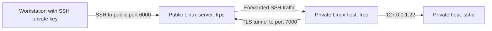

# frp-deploy

[English](README.md) | [简体中文](README.zh-CN.md)

Deploy an FRP server or client on Linux with one command after downloading this project. The installer automates the steps in [FRP 服务部署流程](https://blog.euler0525.cn/posts/ea8330c6/): download verification, configuration, a restricted service account, file permissions, and systemd startup.

Use the interactive setup on a new machine, or supply a TOML file for repeatable deployments. The default FRP version is **0.71.1**. Code, comments, and installer messages are in English.

The server includes a browser-based monitoring dashboard for client connections, proxy status, traffic, and active connections. It runs directly inside `frps`, with no Node.js runtime, database, or separate web service.



The **server** is the public machine running `frps`. The **client** is the private machine running `frpc`, not the workstation from which you connect. The `frp` service account does not allow interactive login; SSH uses a normal account on the private machine.

## Requirements

- Two Linux machines using systemd, with `x86_64`/`amd64` or `aarch64`/`arm64` processors. Ubuntu 24.04 and Debian are suitable targets.
- Root access through `sudo`, Bash 4+, `curl`, `tar`, `sha256sum`, `openssl`, standard coreutils, and account management tools such as `getent` and `useradd`.
- HTTPS access to GitHub Releases from both machines, and an existing SSH service on the private machine.
- A public IP address or domain for the server, plus permission to configure its firewall and cloud security group.

For Ubuntu/Debian, install missing dependencies with `sudo apt update` followed by `sudo apt install -y bash curl ca-certificates tar openssl coreutils passwd libc-bin`. The installer does not install packages or modify your firewall, cloud security group, SSH daemon, or SSH keys. Native Windows, macOS, and containers without systemd are not installation targets. An SSH workstation can use any operating system.

## Quick start

Download this project's source ZIP to each Linux machine and extract it into `frp-deploy`, or clone your published repository. Replace `YOUR_GITHUB_USERNAME` below with the repository owner; this is a publication placeholder, not an existing download endpoint.

```bash
git clone https://github.com/YOUR_GITHUB_USERNAME/frp-deploy.git
cd frp-deploy
```

### Public server

Run `sudo bash install.sh server`. On a fresh installation, answer the prompts for the FRP listening port and allowed proxy ports. Example values are `7000` and `6000`; enter `6000,6001` to allow two separate proxy ports. Use public listening ports from `1024` to `65535` in both the wizard and manual configurations: the supplied service runs without root privileges or low-port binding capabilities. Lower ports require separate service capability changes outside this installer's scope.

Leave the token prompt empty to generate a random 64-character hexadecimal token. If you provide your own token, the wizard requires at least 16 characters. The installer stores it in `/etc/frp/frps.toml` and never prints it. Read `auth.token` privately with `sudo less /etc/frp/frps.toml`, then transfer only the token to the client through a trusted channel. Do not put it into an issue, screenshot, public repository, or shell command argument.

The server wizard enables the monitoring dashboard by default; answer `no` to leave it disabled. When enabled through the wizard, its address is fixed to `127.0.0.1`. The default port is `7500` and username is `admin`; choose a separate dashboard password of at least 16 characters, or leave it empty to generate one. Read `webServer.user` and `webServer.password` privately from the installed server configuration; these are browser login credentials, not the FRP tunnel token. Download the complete repository when installing the server, including its `dashboard/` directory.

### Private client

Run `sudo bash install.sh client` on the private machine. Supply the server's public IP/domain, the server listening port, the same token, a unique proxy name, the local SSH address/port, and the public proxy port. A typical setup is:

| Prompt | Example | Meaning |
| --- | --- | --- |
| Server address | `203.0.113.20` | Replace with the actual public server address. |
| Server port | `7000` | Must match the server's `bindPort`. |
| Authentication token | Hidden input | Must match the server's `auth.token`. |
| Proxy name | `ssh-machine-a` | Unique across clients sharing a server. |
| Local address | `127.0.0.1` | SSH service address as seen from the client. |
| Local port | `22` | The private machine's actual SSH port. |
| Remote port | `6000` | Must be allowed by the server's `allowPorts`. |

The `203.0.113.*` addresses in this README are documentation examples; replace them before use. The client retries if the server is temporarily unavailable. A running systemd service alone does not prove that the proxy has registered or SSH is reachable.

### Open the required network ports

On the **public server**, allow inbound TCP `7000` for the client tunnel and TCP `6000` for SSH users. Use the ports you actually selected. Set matching rules in both the host firewall and your cloud provider's security group. If the private machine has a fixed public egress address, you can also restrict the tunnel port to that address.

For an already configured UFW firewall:

```bash
sudo ufw status verbose
sudo ufw allow 7000/tcp
# Replace this example address with your workstation's public egress IP.
sudo ufw allow from 203.0.113.10 to any port 6000 proto tcp
```

If your workstation has no fixed public egress address, `sudo ufw allow 6000/tcp` is an alternative to the source-restricted rule. It makes the SSH proxy port publicly reachable. Choose the rule that fits your network; adding both leaves the broad rule effective. Do not enable a previously inactive firewall until your existing administrative SSH port is also allowed. The private client normally needs outbound connectivity to the server and no inbound internet rule.

### Configure SSH keys and connect

The installer forwards the existing SSH service; it does not install or configure it. On your workstation, generate a key with `ssh-keygen -t ed25519 -f ~/.ssh/id_ed25519_frp`, and choose a passphrase. Install the contents of `~/.ssh/id_ed25519_frp.pub` in the intended private machine user's `~/.ssh/authorized_keys`, using a trusted existing connection or console. On Linux/macOS, `ssh-copy-id -i ~/.ssh/id_ed25519_frp.pub alice@PRIVATE_HOST` can do this while the private host is directly reachable. Replace `alice` and `PRIVATE_HOST`, and add `-p` if that direct SSH connection uses a custom port. Windows OpenSSH can generate the same key; copy its public key through an existing trusted connection.

Keep the private key on the workstation. On the private host, the target user's `.ssh` directory and `authorized_keys` should belong to that user with permissions `700` and `600`. Verify key login in a separate session before changing SSH authentication settings. If adopting the article's key-only policy, disable password and keyboard-interactive authentication in the effective SSH configuration only after that verification; validate with `sudo sshd -t` before reloading SSH. Keep your current administrative session open during the change.

Once both FRP services are running and the firewall rules are in place, connect from the workstation:

```bash
ssh -i ~/.ssh/id_ed25519_frp -p 6000 alice@203.0.113.20
```

Use the **private machine's username**. The SSH host key is also the private machine's key; verify its fingerprint through a trusted channel on the first connection.

## Deploy with a configuration file

Use the supplied templates when you prefer editing files or provisioning several hosts. On the public server:

```bash
umask 077
cp config/frps.toml.example frps.toml
# Generate the FRP token.
openssl rand -hex 32
# Generate a separate dashboard password.
openssl rand -hex 32
# Set the token and dashboard password to their separate generated values.
nano frps.toml
sudo bash install.sh server --config ./frps.toml
```

On the private machine:

```bash
umask 077
cp config/frpc.toml.example frpc.toml
# Set the public server address, the same token, and your proxy settings.
nano frpc.toml
sudo bash install.sh client --config ./frpc.toml
```

Replace every `REPLACE_WITH_...` value. Do not generate a different token on the client. The local `frps.toml` and `frpc.toml` files are ignored by Git, but still contain secrets: keep them private or remove them after deployment. The installed copies are `/etc/frp/frps.toml` and `/etc/frp/frpc.toml`, owned by `root:frp` with mode `640` inside a mode `750` directory.

For advanced configurations, `--config` copies **only the main TOML file**, not files it references. The bundled dashboard assets are installed separately by the server installer. Use absolute paths for `includes`, certificate files, and token files such as `auth.tokenSource.file.path`. Install those supporting files separately before deployment, preferably under `/etc/frp`, with ownership and permissions that allow the `frp` service to read them. Relative paths can resolve differently during validation and systemd startup. Keep `log.to = "console"` unless you also arrange a permitted writable log location; the supplied unit uses `ProtectSystem=strict`.

### Configuration reference

| Field | File | How to fill it |
| --- | --- | --- |
| `bindAddr` | Server | `0.0.0.0` listens on all IPv4 interfaces; use a specific local server address when needed. |
| `bindPort` | Server | The FRP tunnel port, e.g. `7000`; open this TCP port for clients. |
| `allowPorts` | Server | Only the proxy ports clients may register, e.g. `[{ single = 6000 }]`. |
| `serverAddr` | Client | Public server IP/domain, without `http://`, a path, or a port suffix. |
| `serverPort` | Client | Exactly the server's `bindPort`. |
| `loginFailExit` | Client | `false` keeps retrying when the server is unavailable. |
| `auth.method` | Both | Keep `"token"` for the provided setup. |
| `auth.token` | Both | The same random secret on both hosts; use `openssl rand -hex 32` to create one manually. |
| `auth.additionalScopes` | Both | Keep `["HeartBeats", "NewWorkConns"]` to authenticate these messages too. |
| `transport.tls.force` | Server | Keep `true` to require TLS from clients. |
| `transport.tls.enable` | Client | Keep `true` to enable TLS to the server. |
| `log.to` / `log.level` | Both | `"console"` and `"info"` send normal logs to the systemd journal. |
| `webServer.addr` | Server | Dashboard listening address; keep `"127.0.0.1"` for SSH forwarding. |
| `webServer.port` | Server | Dashboard port, normally `7500`; keep it separate from the tunnel and proxy ports. |
| `webServer.user` / `webServer.password` | Server | Dashboard login credentials; replace the password placeholder with a separate random secret. |
| `webServer.assetsDir` | Server | Keep `"/usr/local/share/frp-deploy/dashboard"` to use this project's frontend. |
| `[[proxies]]` | Client | Starts one proxy definition; repeat the block for more proxies. |
| `name` | Proxy | A unique name such as `"ssh-machine-a"`. |
| `type` | Proxy | `"tcp"` for SSH forwarding. |
| `localIP` | Proxy | `"127.0.0.1"` when SSH runs on the client machine. |
| `localPort` | Proxy | The real internal SSH port, usually `22`. |
| `remotePort` | Proxy | The public SSH proxy port, e.g. `6000`; must match `allowPorts` and firewall rules. |

TLS encrypts the FRP connection in this setup. FRP's automatically generated certificate does **not** establish verified server identity. For server certificate verification, configure the server's `transport.tls.certFile` and `transport.tls.keyFile` and the client's `transport.tls.trustedCaFile`; see the [official TLS documentation](https://gofrp.org/en/docs/features/common/network/network-tls/). Certificate names must match the server identity, and the `frp` service account must be able to read the files. Use absolute paths under `/etc/frp` with suitable `frp` group read permissions. Keep them outside user home directories because the service uses `ProtectHome=true`.

### Multiple private machines

Use the same server address, tunnel port, and token on all clients, but give each proxy a distinct name and public port:

| Private host | Proxy name | Local SSH port | Public proxy port |
| --- | --- | --- | --- |
| A | `ssh-machine-a` | `22` | `6000` |
| B | `ssh-machine-b` | `22` | `6001` |
| C | `ssh-machine-c` | `2222` | `6002` |

On the server, use `allowPorts = [{ start = 6000, end = 6002 }]` in a custom TOML file, or enter `6000,6001,6002` in the initial wizard. Allow each selected port in the firewall and security group. Restart the server after editing its configuration. Each additional `[[proxies]]` block on one client follows the same uniqueness rules.

## Monitoring dashboard

From your workstation, forward the dashboard over your existing SSH connection to the **public server**:

```bash
ssh -N -L 7500:127.0.0.1:7500 server-user@203.0.113.20
```

Replace `server-user` and the address with the public server's SSH account and address. If that SSH service uses another port, add `-p YOUR_SERVER_SSH_PORT`. This connection uses the public server's management SSH service, not the forwarded private-host SSH port `6000`. Keep the command running, open **http://127.0.0.1:7500**, and enter the dashboard username and password in the browser's authentication prompt. No public firewall rule for `7500` is needed with this setup. If local port `7500` is busy, forward `17500:127.0.0.1:7500` and open local port `17500` instead.

The dashboard refreshes every five seconds while the page is visible, supports pausing and manual refresh, and offers proxy search and status/type filters. It shows client identity, address, version, and connection status, including retained records of disconnected clients; open a proxy's details to inspect its traffic history. Inbound traffic travels from an external visitor toward the private service; outbound traffic travels back to the visitor. The overview traffic totals and proxy counters show **today's traffic**, not lifetime totals, using the server's local date. Statistics are held in memory, so restarting `frps` clears them.

The reported traffic rate is calculated from successive counter readings while this page is open. FRP may account for TCP traffic only when a connection closes, so a long-lived SSH session can appear idle and later produce a spike. This chart is not a real-time bandwidth meter or a persistent monitoring database. An online proxy means registration succeeded, not that the private application or SSH authentication is healthy. Failed refreshes are marked as stale instead of replacing the last readings with zero. The panel is read-only and does not change client configurations.

### Enable it on an existing installation

Rerunning the installer preserves your existing configuration, so it will not silently enable a new listening port. Copy the installed file to a private working copy, add the following **top-level** settings before any TOML table headers, and replace the password placeholder. Do not duplicate settings that already exist:

```toml
webServer.addr = "127.0.0.1"
webServer.port = 7500
webServer.user = "admin"
webServer.password = "REPLACE_WITH_A_SEPARATE_DASHBOARD_PASSWORD"
webServer.assetsDir = "/usr/local/share/frp-deploy/dashboard"
```

Run `sudo bash install.sh server --config /path/to/updated-frps.toml` from the complete project directory. The installer installs the frontend assets, backs up the previous files, and restarts `frps`. Existing client configurations remain usable. Later server reinstalls update the bundled dashboard files while preserving the selected configuration.

### HTTPS access without an SSH tunnel

For direct browser access, configure HTTPS before exposing the panel. FRP supports `webServer.tls.certFile` and `webServer.tls.keyFile`; use a certificate matching your dashboard hostname and absolute paths readable by `frp`, such as `/etc/frp/dashboard.crt` and `/etc/frp/dashboard.key`. Set `webServer.addr = "0.0.0.0"`, validate the configuration, restart `frps`, and allow the dashboard TCP port only from trusted source addresses in the host firewall and cloud security group. Then open `https://YOUR_DASHBOARD_HOST:7500`. Alternatively, keep the loopback binding and use an existing HTTPS reverse proxy for the entire dashboard, including `/static/` and `/api/`. Do not expose HTTP Basic Authentication over public plain HTTP. See the [official web interface documentation](https://gofrp.org/en/docs/features/common/ui/) for FRP's HTTPS settings.

## Maintenance

Running the installer again **without** `--config` preserves the installed configuration and restarts the selected service. Passing `--config` explicitly replaces that role's configuration after validation. Existing binary, configuration, unit files, and managed server dashboard assets are backed up under `/var/backups/frp-deploy/` before replacement. Backups contain secrets and are restricted to root. Treat `/usr/local/share/frp-deploy/dashboard` as installer-managed: edit frontend sources in this project's `dashboard/` directory and reinstall to publish changes.

The installer downloads the official release archive and checksum list, checks its SHA-256 digest, and runs the selected binary's `verify` command before installation. The services run as `frp`, start at boot, restart after failure, and use systemd filesystem protections. Deployment or startup failures trigger a best-effort restoration of the previous files and service state; read any rollback error before retrying. Backups remain available for manual recovery.

To select a release explicitly, run `sudo bash install.sh server --version 0.71.1` on the server and `sudo bash install.sh client --version 0.71.1` on the client. Replace the version with your intended compatible release and use the same version on both ends. The default is pinned rather than silently following the latest release; other versions must provide the corresponding official archive and checksum list. The bundled dashboard uses the v0.71.1 dashboard API, including client records and traffic history; check API compatibility when selecting another release.

Useful server commands are below; replace `frps` with `frpc` for the client:

```bash
sudo systemctl status frps --no-pager
sudo journalctl -u frps -n 50 --no-pager
sudo journalctl -u frps -f
sudo /usr/local/bin/frps verify -c /etc/frp/frps.toml
sudo systemctl restart frps
```

For direct configuration edits, validate the file before restarting. If you edit files manually, save your own backup first; installer backups cover installer replacements. A version rollback uses the installer with the old compatible version; if the configuration changed too, restore the corresponding configuration with `--config`.

### Verify the tunnel

Check the private SSH listener with `sudo ss -lntp '( sport = :22 )'`. In `sudo journalctl -u frpc -n 50 --no-pager`, look for successful login and successful proxy registration. On the server, `sudo ss -lntp '( sport = :7000 or sport = :6000 )'` should show both ports after registration. The proxy port normally appears only after a client registers it. Finally, test the actual SSH command from your workstation; this also exercises external firewall rules.

| Symptom | Check |
| --- | --- |
| Client cannot connect to the server | Address, `bindPort`/`serverPort`, routing, outbound rules, host firewall, and cloud security group. |
| Authentication fails | Matching token and `auth.additionalScopes` on both hosts. |
| Proxy registration fails | Duplicate proxy names, occupied remote ports, or a missing `allowPorts` entry. |
| Proxy connects but SSH fails | Actual `localIP`/`localPort`, SSH service, private machine username, public key, and file permissions. |
| Service is active but no proxy port exists | Read client logs; retrying a connection does not mean registration succeeded. |
| Download or checksum fails | Connectivity to official GitHub release assets, requested version, and published checksum; do not bypass verification. |
| Dashboard cannot open | Check `webServer` settings, the SSH forwarding command, `frps` logs, and the browser username/password. The dashboard password is separate from `auth.token`. |
| Dashboard shows stale data | Check the server connection and logs; reload to renew browser authentication. Keep both `/static/` and `/api/` accessible through any reverse proxy. |
| Traffic looks idle during an active SSH session | FRP can defer TCP traffic accounting until the connection closes; current connection count is independent of that accounting. |

### Uninstall

On the server, remove the installed service and binary:

```bash
sudo systemctl disable --now frps
sudo rm -f /etc/systemd/system/frps.service /usr/local/bin/frps
sudo systemctl daemon-reload
sudo systemctl reset-failed
```

On the client, use the same commands with `frpc` in place of `frps`. These commands keep `/etc/frp`, backups, the server dashboard assets under `/usr/local/share/frp-deploy/dashboard`, and the shared `frp` account. Remove the corresponding configuration, dashboard assets, and backups separately only when no longer needed; another FRP role may use the same account and configuration directory. Remove any firewall/security-group rules you added once they are no longer required.

## License and references

This deployment project is licensed under [MIT](LICENSE). [FRP](https://github.com/fatedier/frp) is a separate project under Apache-2.0; the installer downloads its official binaries and does not change their license.

- Original workflow: [FRP 服务部署流程 — Euler0525](https://blog.euler0525.cn/posts/ea8330c6/).
- Default release: [FRP v0.71.1](https://github.com/fatedier/frp/releases/tag/v0.71.1).
- Official guides: [systemd](https://gofrp.org/en/docs/setup/systemd/), [authentication](https://gofrp.org/en/docs/features/common/authentication/), and [server configuration](https://gofrp.org/en/docs/reference/server-configures/).
