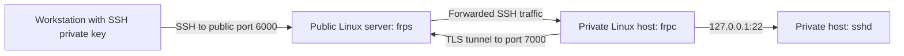

# frp-deploy

[English](README.md) | [简体中文](README.zh-CN.md)

下载项目后，通过一条命令部署 Linux 上的 FRP 服务端或客户端。本项目将 [FRP 服务部署流程](https://blog.euler0525.cn/posts/ea8330c6/) 中的下载校验、配置生成、受限账户创建、文件权限设置和 systemd 服务启动整合为自动化脚本。

首次部署可以使用交互向导，也可以传入 TOML 配置文件，方便重复部署。默认 FRP 版本为 **0.71.1**。代码、注释和安装提示均使用英文。

服务端提供浏览器可视化监控面板，查看客户端连接、代理状态、流量及当前连接数。面板直接由 `frps` 提供，无需安装 Node.js、数据库或额外 Web 服务。



**服务端**是运行 `frps` 的公网机器，**客户端**是运行 `frpc` 的内网机器；发起 SSH 登录的个人电脑不需要安装 `frpc`。脚本创建的 `frp` 是禁止交互登录的服务账户，SSH 登录时应使用内网机器上的普通用户。

## 环境要求

- 两台使用 systemd 的 Linux 机器，处理器为 `x86_64`/`amd64` 或 `aarch64`/`arm64`，例如 Ubuntu 24.04 或 Debian。
- 可以通过 `sudo` 获得 root 权限，具有 Bash 4+、`curl`、`tar`、`sha256sum`、`openssl`、标准 coreutils，以及 `getent`、`useradd` 等账户管理工具。
- 两台机器均可通过 HTTPS 下载 GitHub Releases 中的文件，内网机器已经运行 SSH 服务。
- 服务端具有公网 IP 或域名，并且你有权限配置其防火墙和云安全组。

Ubuntu/Debian 可以先执行 `sudo apt update`，再执行 `sudo apt install -y bash curl ca-certificates tar openssl coreutils passwd libc-bin` 安装缺少的依赖。脚本不会安装系统软件包，也不会修改防火墙、云安全组、SSH 服务或密钥。安装目标不包括原生 Windows、macOS，以及没有 systemd 的容器；用于发起 SSH 连接的个人电脑可以使用任意系统。

## 快速开始

在两台 Linux 机器上下载项目源码 ZIP，解压到 `frp-deploy`，或者克隆你发布后的仓库。下面的 `YOUR_GITHUB_USERNAME` 是发布占位符，需要替换为实际仓库所有者，并非已经存在的下载地址。

```bash
git clone https://github.com/YOUR_GITHUB_USERNAME/frp-deploy.git
cd frp-deploy
```

### 部署公网服务端

执行 `sudo bash install.sh server`。首次安装时，按提示填写 FRP 隧道监听端口和允许客户端使用的代理端口，例如 `7000` 和 `6000`；需要两个代理端口时可以输入 `6000,6001`。无论使用向导还是手动配置，公网监听端口都应选择 `1024`～`65535`：项目提供的服务以普通系统账户运行，不授予低端口绑定能力。使用更低的端口需要另行调整服务能力，不属于本安装脚本的处理范围。

Token 提示直接留空即可自动生成 64 位十六进制随机密钥。手动输入 Token 时，向导要求至少 16 个字符。脚本只把它保存到 `/etc/frp/frps.toml`，不会在安装输出中显示。通过 `sudo less /etc/frp/frps.toml` 私下查看 `auth.token`，再通过可信渠道传给客户端。不要把真实 Token 放进公开仓库、Issue、截图或命令行参数。

服务端向导默认启用监控面板，输入 `no` 可以关闭。通过向导启用时，监听地址固定为 `127.0.0.1`，默认端口为 `7500`，默认用户名为 `admin`。填写至少 16 个字符的独立面板密码，或留空自动生成。通过已安装的服务端配置文件私下查看 `webServer.user` 和 `webServer.password`，它们用于浏览器登录，与 FRP 隧道 Token 不同。安装服务端时需要下载完整项目，包括 `dashboard/` 目录。

### 部署内网客户端

在内网机器执行 `sudo bash install.sh client`，填写公网服务端地址、监听端口、相同 Token、唯一的代理名称、内网 SSH 地址和端口，以及公网代理端口。一个常见配置如下。

| 提示项 | 示例值 | 填写方式 |
| --- | --- | --- |
| Server address | `203.0.113.20` | 替换为服务端真实公网 IP 或域名。 |
| Server port | `7000` | 必须与服务端 `bindPort` 一致。 |
| Authentication token | 隐藏输入 | 与服务端 `auth.token` 完全一致。 |
| Proxy name | `ssh-machine-a` | 同一服务端上的各个客户端不能重名。 |
| Local address | `127.0.0.1` | 从客户端机器访问 SSH 服务时使用的地址。 |
| Local port | `22` | 内网机器实际使用的 SSH 端口。 |
| Remote port | `6000` | 必须包含在服务端 `allowPorts` 中。 |

本文中的 `203.0.113.*` 地址仅用于举例，使用前需要替换。服务端暂时不可用时，客户端会继续重试。systemd 显示服务运行中，只代表进程已运行，不代表代理已经注册成功或 SSH 已经连通。

### 放行网络端口

在**公网服务端**放行客户端建立隧道使用的 TCP `7000`，以及访问 SSH 代理使用的 TCP `6000`；如果更改了端口，规则也应同步更改。服务器防火墙和云平台安全组都需要配置。如果内网机器有固定的公网出口地址，也可以将隧道端口限制为仅允许该地址访问。

对于已经配置好的 UFW 防火墙，可以执行：

```bash
sudo ufw status verbose
sudo ufw allow 7000/tcp
# Replace this example address with your workstation's public egress IP.
sudo ufw allow from 203.0.113.10 to any port 6000 proto tcp
```

如果个人电脑没有固定公网出口 IP，可以用 `sudo ufw allow 6000/tcp` 替代上面的来源限制规则，这会让公网 SSH 代理端口对所有来源开放。根据实际情况选择一种；同时添加两种规则时，较宽泛的规则仍会生效。如果 UFW 原本未启用，应先确保当前用于管理服务器的 SSH 端口已经放行，再决定是否启用。内网客户端通常只需要能够主动连接服务端，不需要在公网放行入站端口。

### 配置 SSH 密钥并连接

脚本转发的是已有的 SSH 服务，不负责安装或配置 SSH。在个人电脑上执行 `ssh-keygen -t ed25519 -f ~/.ssh/id_ed25519_frp` 生成密钥，并设置私钥口令。通过已有的可信连接或控制台，将 `~/.ssh/id_ed25519_frp.pub` 的内容安装到内网机器目标用户的 `~/.ssh/authorized_keys`。如果当前能直接访问内网机器，Linux/macOS 可以执行 `ssh-copy-id -i ~/.ssh/id_ed25519_frp.pub alice@PRIVATE_HOST`；替换 `alice` 和 `PRIVATE_HOST`，直接连接使用非默认 SSH 端口时加上 `-p` 参数。Windows OpenSSH 同样可以生成该密钥，再通过已有可信连接安装公钥。

私钥始终保留在个人电脑上。内网目标用户的 `.ssh` 目录及 `authorized_keys` 应归该用户所有，权限分别为 `700` 和 `600`。先在另一个会话验证公钥登录成功，再修改 SSH 认证方式。如果采用原文的仅公钥认证方案，应在验证后关闭有效 SSH 配置中的密码认证及键盘交互认证，并先执行 `sudo sshd -t` 校验，再重新加载 SSH 服务；操作时保留现有管理会话。

两端服务运行、代理注册成功并放行端口后，在个人电脑上执行：

```bash
ssh -i ~/.ssh/id_ed25519_frp -p 6000 alice@203.0.113.20
```

这里使用的是**内网机器的用户名**。首次连接时看到的 SSH 主机密钥也属于内网机器，应通过可信渠道核对指纹。

## 使用配置文件部署

如果希望手动填写配置，或批量准备多台机器，可以使用项目中的模板。在公网服务端执行：

```bash
umask 077
cp config/frps.toml.example frps.toml
# Generate the FRP token.
openssl rand -hex 32
# Generate a separate dashboard password.
openssl rand -hex 32
# Set the token and dashboard password to their separate generated values.
nano frps.toml
sudo bash install.sh server --config ./frps.toml
```

在内网客户端执行：

```bash
umask 077
cp config/frpc.toml.example frpc.toml
# Set the public server address, the same token, and your proxy settings.
nano frpc.toml
sudo bash install.sh client --config ./frpc.toml
```

替换所有 `REPLACE_WITH_...` 占位内容。客户端必须填写服务端已有的 Token，不要重新生成另一份。本地 `frps.toml` 和 `frpc.toml` 已加入 Git 忽略规则，但仍然包含密钥，应妥善保存或在部署后删除。安装后的文件位于 `/etc/frp/frps.toml` 和 `/etc/frp/frpc.toml`，属主和属组为 `root:frp`，文件权限为 `640`，配置目录权限为 `750`。

使用高级配置时，`--config` **只复制主 TOML 文件**，不会复制配置中引用的其他文件；项目附带的面板资源由服务端安装流程另行安装。`includes`、证书文件，以及 `auth.tokenSource.file.path` 等 Token 文件路径都应使用绝对路径。在部署之前自行安装这些依赖文件，建议放在 `/etc/frp` 下，并设置允许 `frp` 服务读取的属主、属组和权限。相对路径在配置校验与 systemd 启动时可能指向不同位置。建议保留 `log.to = "console"`；服务启用了 `ProtectSystem=strict`，如果改为文件日志，还需要单独配置允许写入的日志位置。

### 配置字段说明

| 字段 | 所在文件 | 如何填写 |
| --- | --- | --- |
| `bindAddr` | 服务端 | `0.0.0.0` 表示监听所有 IPv4 接口；需要时改为服务端的指定本地地址。 |
| `bindPort` | 服务端 | FRP 隧道端口，例如 `7000`，需要向客户端放行此 TCP 端口。 |
| `allowPorts` | 服务端 | 允许客户端注册的代理端口，例如 `[{ single = 6000 }]`。 |
| `serverAddr` | 客户端 | 服务端公网 IP 或域名，不加 `http://`、路径或端口后缀。 |
| `serverPort` | 客户端 | 与服务端的 `bindPort` 一致。 |
| `loginFailExit` | 客户端 | 保留 `false`，服务端不可用时持续重试。 |
| `auth.method` | 两端 | 使用模板中的 `"token"`。 |
| `auth.token` | 两端 | 两端完全相同的随机密钥，手动创建时使用 `openssl rand -hex 32`。 |
| `auth.additionalScopes` | 两端 | 保留 `["HeartBeats", "NewWorkConns"]`，为这些消息也启用认证。 |
| `transport.tls.force` | 服务端 | 保留 `true`，要求客户端使用 TLS。 |
| `transport.tls.enable` | 客户端 | 保留 `true`，启用到服务端的 TLS。 |
| `log.to` / `log.level` | 两端 | 使用 `"console"` 和 `"info"`，通过 systemd 日志查看运行信息。 |
| `webServer.addr` | 服务端 | 面板监听地址；通过 SSH 转发访问时保留 `"127.0.0.1"`。 |
| `webServer.port` | 服务端 | 面板端口，通常为 `7500`，不能与隧道端口、代理端口重复。 |
| `webServer.user` / `webServer.password` | 服务端 | 面板登录凭据，密码占位符应替换为独立的随机密钥。 |
| `webServer.assetsDir` | 服务端 | 保留 `"/usr/local/share/frp-deploy/dashboard"`，使用本项目前端。 |
| `[[proxies]]` | 客户端 | 开始一个代理定义；多个代理可以重复添加此配置块。 |
| `name` | 代理 | 使用唯一名称，例如 `"ssh-machine-a"`。 |
| `type` | 代理 | SSH 转发使用 `"tcp"`。 |
| `localIP` | 代理 | SSH 服务位于客户端本机时使用 `"127.0.0.1"`。 |
| `localPort` | 代理 | 内网 SSH 的实际端口，通常为 `22`。 |
| `remotePort` | 代理 | 公网 SSH 代理端口，例如 `6000`，需要与 `allowPorts` 和防火墙规则对应。 |

本方案通过 TLS 加密 FRP 连接，但 FRP 自动生成的证书**不会验证服务端身份**。需要验证服务端证书时，在服务端配置 `transport.tls.certFile` 和 `transport.tls.keyFile`，在客户端配置 `transport.tls.trustedCaFile`，具体见 [FRP 官方 TLS 文档](https://gofrp.org/en/docs/features/common/network/network-tls/)。证书中的名称应与服务端身份匹配，文件必须允许 `frp` 账户读取。建议使用 `/etc/frp` 下的绝对路径，并设置合适的 `frp` 组读取权限；服务启用了 `ProtectHome=true`，不要把证书放在用户主目录中。

### 多台内网机器

多个客户端可以使用相同的服务端地址、隧道端口和 Token，但代理名称和公网端口必须不同。

| 内网机器 | 代理名称 | 内网 SSH 端口 | 公网代理端口 |
| --- | --- | --- | --- |
| A | `ssh-machine-a` | `22` | `6000` |
| B | `ssh-machine-b` | `22` | `6001` |
| C | `ssh-machine-c` | `2222` | `6002` |

服务端手动配置可使用 `allowPorts = [{ start = 6000, end = 6002 }]`，首次安装向导则输入 `6000,6001,6002`。在防火墙和云安全组中放行相应端口，修改服务端配置后重启服务。同一客户端新增多个 `[[proxies]]` 配置块时，也要遵守名称和公网端口不能重复的要求。

## 可视化监控面板

在个人电脑上，通过现有 SSH 连接将**公网服务器**的面板转发到本机：

```bash
ssh -N -L 7500:127.0.0.1:7500 server-user@203.0.113.20
```

将用户名和地址替换为公网服务器的实际 SSH 账号与地址；该 SSH 服务不是默认端口时，加上 `-p YOUR_SERVER_SSH_PORT`。这里连接的是公网服务器的管理 SSH 服务，而不是访问内网机器的代理端口 `6000`。保持命令运行，在浏览器打开 **http://127.0.0.1:7500**，按浏览器认证提示输入面板用户名和密码。该访问方式不需要向公网开放 `7500`。如果本机端口已经占用，可改为转发 `17500:127.0.0.1:7500`，然后访问本机 `17500` 端口。

面板在页面可见时每五秒自动刷新，支持暂停、手动刷新，以及代理搜索、状态和类型筛选，并展示客户端标识、地址、版本和连接状态，包括尚未清理的已断开客户端记录。打开代理详情可以查看流量历史。入站流量表示外部访问者到内网服务的方向，出站流量表示返回访问者的方向。概览流量总数和代理流量计数都是按服务端本地日期统计的**今日流量**，不是自启动以来的累计值。统计数据保存在内存中，重启 `frps` 后会清空。

页面中的已上报流量速率由相邻两次计数计算。FRP 可能在 TCP 连接关闭后才计入流量，因此长期保持的 SSH 会话可能暂时显示空闲，结束后出现峰值；该曲线不是真实瞬时带宽，也不是持久化监控数据库。代理在线表示注册成功，不代表内网应用或 SSH 认证一定正常。刷新失败时会明确标记数据过期，保留最后一次读数，不会显示成零。面板仅用于监控，不修改客户端配置。

### 为已有服务启用面板

重新运行安装脚本会保留原配置，不会自动开启新的监听端口。先将已安装配置复制到一份私有工作副本，在所有 TOML 表头之前加入以下**顶层配置**，并替换密码占位符；已经存在的字段不要重复添加：

```toml
webServer.addr = "127.0.0.1"
webServer.port = 7500
webServer.user = "admin"
webServer.password = "REPLACE_WITH_A_SEPARATE_DASHBOARD_PASSWORD"
webServer.assetsDir = "/usr/local/share/frp-deploy/dashboard"
```

在完整项目目录运行 `sudo bash install.sh server --config /path/to/updated-frps.toml`。脚本会安装前端资源、备份旧文件并重启 `frps`，已有客户端配置可以继续使用。以后重跑服务端安装会更新附带的面板文件，同时保留所选配置。

### 不使用 SSH 隧道的 HTTPS 访问

如果需要直接通过浏览器访问公网面板，应先配置 HTTPS。FRP 支持 `webServer.tls.certFile` 和 `webServer.tls.keyFile`，使用与面板域名匹配的证书，并采用允许 `frp` 读取的绝对路径，例如 `/etc/frp/dashboard.crt` 和 `/etc/frp/dashboard.key`。将 `webServer.addr` 改为 `"0.0.0.0"`，校验配置并重启服务，再在主机防火墙和云安全组中仅对可信来源放行面板 TCP 端口，通过 `https://YOUR_DASHBOARD_HOST:7500` 访问。也可以保留本机监听，使用已有 HTTPS 反向代理转发整个面板，包括 `/static/` 和 `/api/`。不要通过公网明文 HTTP 传输浏览器登录凭据。HTTPS 参数见 [FRP 官方 Web 界面说明](https://gofrp.org/en/docs/features/common/ui/)。

## 日常维护

再次运行安装命令时，**不传 `--config` 会保留已安装的配置**，并重启所选服务；显式传入 `--config` 才会在校验通过后替换对应配置。替换前，旧的二进制文件、配置文件、服务定义及已由脚本管理的面板资源会备份到 `/var/backups/frp-deploy/`。备份包含密钥，仅允许 root 访问。`/usr/local/share/frp-deploy/dashboard` 由安装脚本管理；修改前端时应编辑项目中的 `dashboard/` 源文件，再重新安装以更新页面。

脚本从官方 Release 下载压缩包和校验列表，验证 SHA-256 后，调用对应程序的 `verify` 命令校验配置，再执行安装。服务以 `frp` 用户运行，设置开机自启、失败重启，并启用 systemd 文件系统保护。部署或启动失败时，脚本会尽力恢复之前的文件和服务状态；如果输出了恢复失败信息，应先处理该错误再重试，原有备份仍可用于手动恢复。

需要指定版本时，服务端执行 `sudo bash install.sh server --version 0.71.1`，客户端执行 `sudo bash install.sh client --version 0.71.1`。将版本号替换为你需要的兼容版本，并保持两端一致。默认版本固定，不会自动跟随最新版本；其他版本也必须提供对应的官方压缩包和校验列表。附带面板使用 v0.71.1 的管理接口，包括客户端记录和流量历史，选择其他版本时还需要检查接口兼容性。

下面是服务端常用命令，管理客户端时将其中的 `frps` 替换为 `frpc`。

```bash
sudo systemctl status frps --no-pager
sudo journalctl -u frps -n 50 --no-pager
sudo journalctl -u frps -f
sudo /usr/local/bin/frps verify -c /etc/frp/frps.toml
sudo systemctl restart frps
```

直接编辑配置文件时，应先自行备份，再校验配置并重启；安装脚本的备份覆盖的是脚本执行替换时的旧文件。回退程序版本可以重新运行安装脚本并指定旧的兼容版本，如果配置也有变化，还需要通过 `--config` 恢复对应版本的配置。

### 检查隧道是否连通

在内网机器执行 `sudo ss -lntp '( sport = :22 )'`，确认 SSH 服务正在监听。通过 `sudo journalctl -u frpc -n 50 --no-pager` 检查登录服务端和注册代理成功的信息。在服务端执行 `sudo ss -lntp '( sport = :7000 or sport = :6000 )'`，代理注册完成后应能看到两个端口；客户端尚未注册时，看不到公网代理端口是正常现象。最后从个人电脑实际执行 SSH 连接，同时检查外部防火墙规则是否生效。

| 问题 | 检查内容 |
| --- | --- |
| 客户端连不上服务端 | 地址、`bindPort`/`serverPort`、路由、出站规则、主机防火墙和云安全组。 |
| Token 认证失败 | 两端 Token 和 `auth.additionalScopes` 是否一致。 |
| 代理注册失败 | 代理名称重复、公网端口已被占用，或未包含在 `allowPorts` 中。 |
| 代理已连接但 SSH 失败 | `localIP`/`localPort`、SSH 服务、内网用户名、公钥及文件权限。 |
| 服务运行中但没有代理端口 | 查看客户端日志；持续重试连接不等于代理已注册成功。 |
| 下载或校验失败 | 官方 GitHub 下载地址是否可访问、版本是否存在、校验值是否一致；不要跳过校验。 |
| 面板打不开 | 检查 `webServer` 配置、SSH 转发命令、`frps` 日志和浏览器登录凭据；面板密码与 `auth.token` 不同。 |
| 面板提示数据过期 | 检查服务端连接和日志；重新加载页面以重新认证，使用反向代理时需同时支持 `/static/` 和 `/api/`。 |
| SSH 正在使用但流量没有变化 | FRP 可能在 TCP 连接关闭后才计入流量，当前连接数与该流量计数独立。 |

### 卸载

在服务端停止并删除服务和程序：

```bash
sudo systemctl disable --now frps
sudo rm -f /etc/systemd/system/frps.service /usr/local/bin/frps
sudo systemctl daemon-reload
sudo systemctl reset-failed
```

在客户端将命令中的 `frps` 替换为 `frpc`。以上操作保留 `/etc/frp`、备份、`/usr/local/share/frp-deploy/dashboard` 下的面板资源和共用的 `frp` 账户；确认不再需要后，可以单独删除对应配置、面板资源和备份。同机另一个 FRP 角色可能仍在使用同一账户和配置目录，不要一并删除。之前添加的防火墙和云安全组规则不再需要时，也应单独清理。

## 许可与参考

本部署项目采用 [MIT 许可证](LICENSE)。[FRP](https://github.com/fatedier/frp) 是独立项目，采用 Apache-2.0；脚本下载其官方二进制文件，不改变上游许可证。

- 原始部署流程：[FRP 服务部署流程 — Euler0525](https://blog.euler0525.cn/posts/ea8330c6/)。
- 默认版本：[FRP v0.71.1](https://github.com/fatedier/frp/releases/tag/v0.71.1)。
- 官方说明：[systemd](https://gofrp.org/en/docs/setup/systemd/)、[认证](https://gofrp.org/en/docs/features/common/authentication/) 和 [服务端配置](https://gofrp.org/en/docs/reference/server-configures/)。
